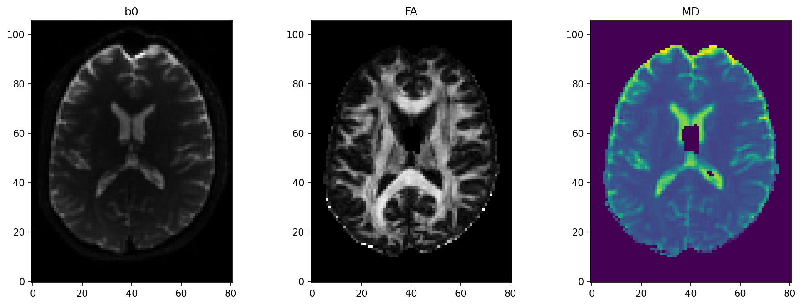
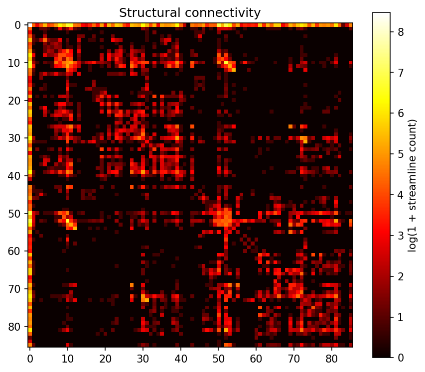

# Brain Connectivity Explorer

A small, reproducible prototype that goes from **diffusion MRI** to a **map of white matter connections**,
simulates **damage to those connections**, and (as a separate part) predicts **dementia status** from
demographics and brain volume. Built as a first step toward research on how connection damage can support
diagnosis and prognosis in mixed dementia.

**Read this first:** the imaging data come from one healthy volunteer, the lesions are simulated, and the
tabular data come from different people. The parts are independent demonstrations. Nothing here links a
person's connectivity to their cognition (see [Limitations](#limitations)).

## What it does

| Step | What | Where |
|---|---|---|
| 1 | Brain mask, diffusion tensor fit, FA and MD maps | notebook, section 2 |
| 2 | Deterministic tractography, then a structural connectivity matrix (86 atlas regions) and graph measures | notebook, sections 3 and 4 |
| 3 | Spherical synthetic lesions that cut fibres, with the resulting disconnection | notebook section 5, app tab "Lesion simulation" |
| 4 | Dementia model on OASIS (demographics and brain volume, grouped cross-validation) | notebook section 7, app tab "Dementia model" |



## Results

| Measure | Value |
|---|---|
| Streamlines (after length filter and subsampling) | 40,000 (15,000 sample used live in the app) |
| Connectivity matrix | 86 x 86, 1,107 region pairs with at least one streamline |
| Global efficiency / density (pairs with at least 3 streamlines) | 0.573 / 0.173 |
| OASIS model (logistic regression, Demented vs Nondemented) | accuracy 69.7% (SD 2.9), ROC-AUC 0.76 |

Lesion size versus damage (lesion in the densest white matter, 40,000 streamlines):

| Radius (voxels) | Streamlines cut | Region pairs fully disconnected |
|---|---|---|
| 2 | 1.7% | 1.5% |
| 4 | 5.6% | 7.1% |
| 6 | 8.8% | 11.8% |
| 8 | 13.1% | 15.7% |
| 10 | 18.8% | 19.1% |



The OASIS accuracy is modest on purpose. MMSE and CDR are excluded because the dementia label is defined
from them, and validation is grouped by subject so one person never appears in both train and test. An
earlier random forest on the same data scored lower (accuracy 0.63, AUC 0.66, before dropping the ambiguous
*Converted* group). Coefficients describe how the model weighs its inputs, not causal effects; for example
age gets a negative weight, most likely because brain volume already captures age-related shrinkage.

## Project layout

```
brain-connectivity-explorer/
├── app/app.py                 Streamlit app (5 tabs)
├── src/
│   ├── loaders.py             read the files made by the notebook
│   ├── connectivity.py        graph measures
│   ├── lesions.py             lesions and disconnection (plain NumPy, no DIPY needed)
│   └── prediction.py          load and run the OASIS model
├── models/                    files exported by the notebook
│   ├── streamlines_small.trk  15,000 streamlines
│   ├── volumes.npz            FA, MD, atlas, mask, connectivity matrix
│   ├── lesion_sweep.csv       notebook lesion sweep
│   ├── oasis_model.pkl        trained model (like saved CNN weights)
│   ├── oasis_params.json      same model as plain numbers (fallback if the pickle will not load)
│   └── oasis_meta.json        scores and coefficients
├── notebooks/01_pipeline.ipynb  the full analysis (run on Kaggle)
├── scripts/export_model_params.py
├── tests/test_core.py
├── docs/figures/
├── .streamlit/config.toml     theme
└── requirements.txt
```

## Run the app

Python 3.10 to 3.13. From the project folder:

**Windows (PowerShell)**
```powershell
python -m venv .venv
.venv\Scripts\Activate.ps1
pip install -r requirements.txt
streamlit run app/app.py
```
If PowerShell blocks the activate script, run `Set-ExecutionPolicy -Scope Process Bypass` first.

**macOS / Linux**
```bash
python -m venv .venv
source .venv/bin/activate
pip install -r requirements.txt
streamlit run app/app.py
```

The app opens at http://localhost:8501. The first load takes a few seconds while the streamlines are read;
after that the lesion sliders respond instantly.

Run the tests (they also check that the NumPy lesion code gives identical results to DIPY, if DIPY is installed):
```bash
pip install pytest
pytest -q
```

## Re-run the analysis

Upload `notebooks/01_pipeline.ipynb` to Kaggle with Internet on, then Run All. DIPY downloads the Stanford
data and the notebook pulls OASIS with `kagglehub`. Download the files it writes to `/kaggle/working`
(`results.zip`) and replace the ones in `models/`. DIPY is only needed for the notebook, not for the app.

If you retrain the OASIS model, run `python scripts/export_model_params.py` afterwards to refresh
`oasis_params.json`.

## Deploy (optional)

Push the folder to GitHub (the largest file is about 31 MB, under GitHub's 100 MB limit) and create an app on
Streamlit Community Cloud with main file `app/app.py`.

## Data

- **Stanford HARDI** diffusion MRI and atlas, downloaded through DIPY (`stanford_hardi`, `stanford_labels`).
- **OASIS longitudinal**, from Kaggle: https://www.kaggle.com/datasets/jboysen/mri-and-alzheimers
- **Lesions**: synthetic spheres generated by `src/lesions.py`.

## Limitations

- One healthy subject for imaging, other people for the tabular model. No person-level link between
  connectivity and cognition.
- Lesions are simulated spheres, not real vascular or neurodegenerative damage.
- Single high b-value (2000 s/mm2), so FA and MD differ from typical clinical DTI.
- Deterministic tractography includes some false connections; graph measures depend on the minimum-streamline
  threshold. Atlas regions are shown by numeric ID.
- OASIS has about 150 people; the model is a demonstration, not a diagnostic tool. Subjects labelled
  *Converted* were excluded because their label is ambiguous.
- The live lesion numbers use a 15,000-streamline sample, so they differ slightly from the notebook sweep.

## What a full study would change

Patient diffusion MRI together with cognitive scores from the same people, lesion masks and connectivity
derived per person, and a test of whether connection damage adds to diagnosis, staging and prediction of
decline beyond demographics and brain volume.
